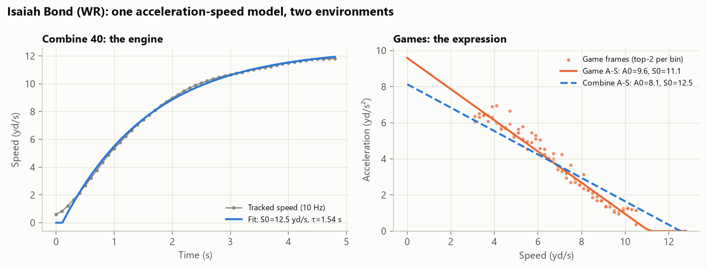
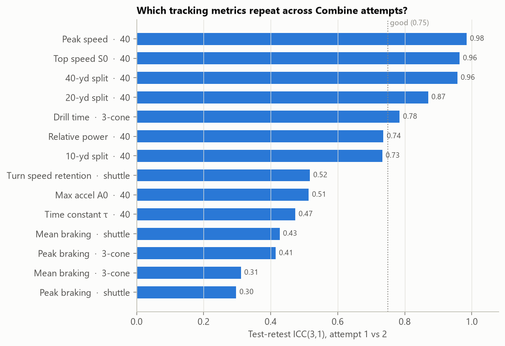
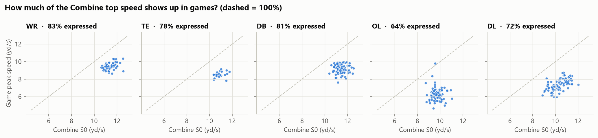
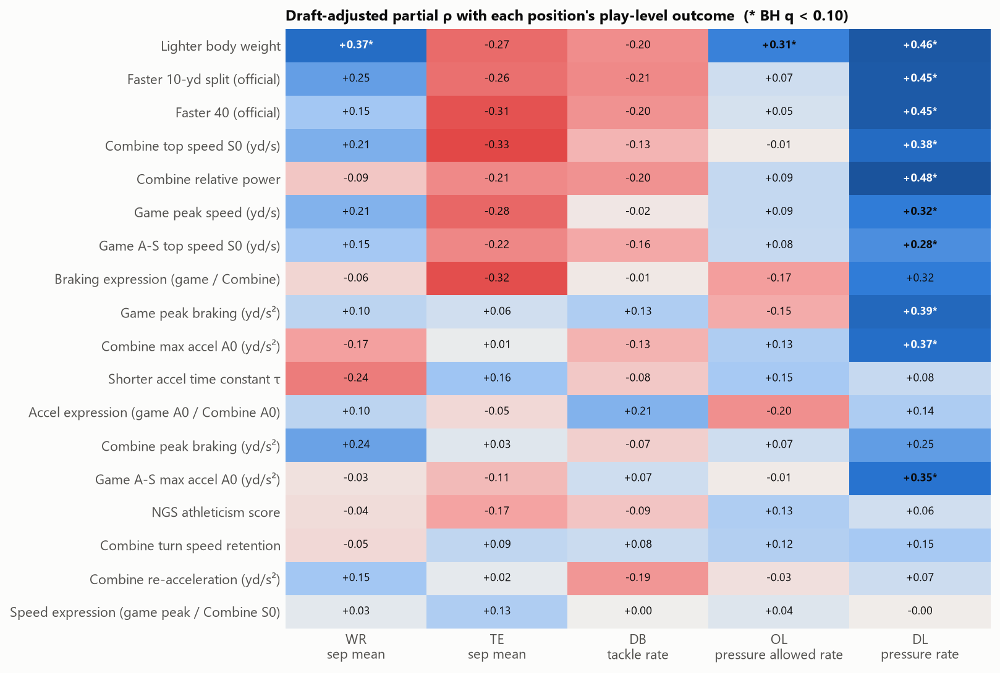
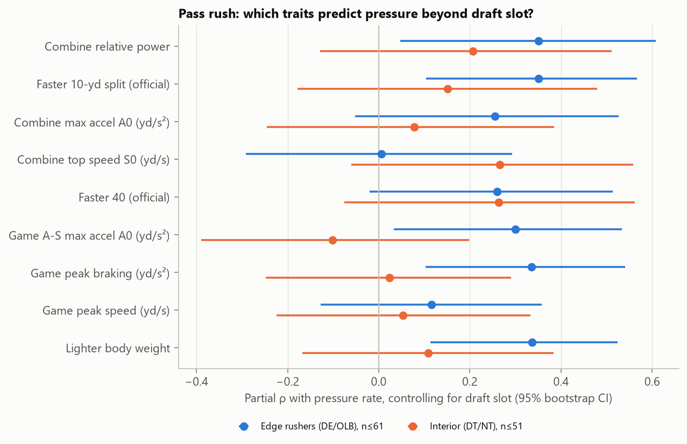
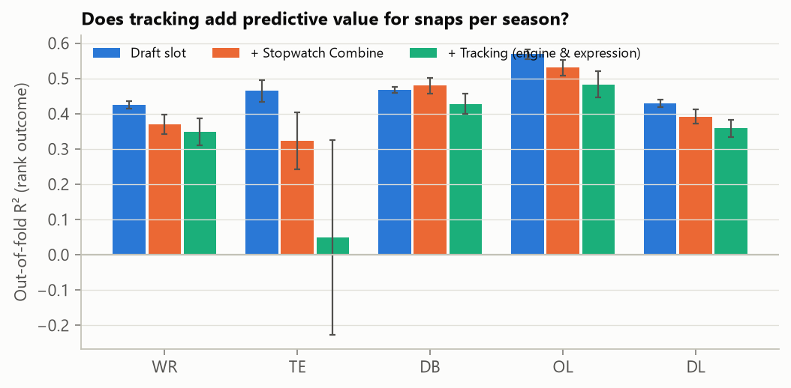

# Engine vs. Expression: Which Combine Athleticism Shows Up on Sundays?

*NFL Big Data Bowl 2027 · Open Track*

## Summary

We fit **one physics model**, the acceleration–speed (A–S) profile, to every prospect twice: once to his 10 Hz Combine 40-yard dash (the **engine**) and once to his NFL game tracking (the **expression**). Across 510 prospects from the 2023–2025 classes, four results stand out:

1. **Top speed is a trait; turning is not (yet).** Tracked top speed repeats almost perfectly between 40 attempts (ICC 0.96). Braking and turn metrics from the shuttle and three-cone do not (ICC 0.23–0.52).
2. **Combine speed shows up in games for DL (ρ = 0.59) and WR (0.48), but not for DB or OL (≈0).** Players use about 83% (WR) down to 64% (OL) of their Combine top speed in games.
3. **For playing time, the draft has already priced athleticism in.** Once we control for draft slot, no Combine or in-game speed metric predicts snaps or starts at any position. A naive analysis says the opposite, and we show why that is an artefact of exposure.
4. **Edge rushers are the exception. Draft the first step, not the top speed.** Beyond draft slot, Combine relative power (partial ρ = +0.35), the 10-yard split (+0.35) and in-game acceleration and braking (+0.30, +0.34) predict pass-rush pressure rate. Top speed predicts nothing (+0.01).

## 1. One model, two environments

A sprint from a standstill follows `v(t) = S0 · (1 − e^{−(t−t0)/τ})` closely. This implies a straight-line relation between acceleration and speed, `a(v) = A0 · (1 − v/S0)`, where **S0** is top speed and **A0 = S0/τ** is maximal acceleration (Samozino et al., 2016). Morin et al. (2021) showed the same line can be recovered *in situ* from match tracking. Pool every frame a player ran above 3 yd/s, keep the two highest tangential accelerations in each 0.2 yd/s speed bin, and fit a robust line.

We do both for every player (Figure 1). Speed and *tangential* acceleration are rebuilt from x/y. The Combine `dis` field is unreliable, and the supplied `a` includes the centripetal acceleration of turns.

*Figure 1. Isaiah Bond. Left: tracked Combine 40 with the sprint fit (r² > 0.99 for the median attempt). Right: in-game A–S points and fit (orange) against the Combine-implied line (dashed blue).*

**Validation.** The 40 time measured from our tracking correlates 0.96 with the official 40, and fitted top speed correlates −0.94 with it. The physics captures what the stopwatch measures, and more.

**Equal exposure.** Peak-based game metrics rise with the number of chances a player gets, and starters get more chances. We therefore measure every player on **the same 80 randomly sampled plays**. Players with fewer tracked plays are excluded rather than measured on less data, which leaves 425 players with an in-game profile. After this step, in-game metrics are unrelated to total plays (ρ between −0.03 and −0.09).

**Outcomes.** Snaps and starts per available season (position-appropriate snaps), plus one play-level outcome per position: separation at the throw (WR/TE), pressure-allowed rate (OL), pressure rate per pass rush (DL) and tackle rate (DB; solo tackles = 1, assists = 0.5).

## 2. Which tracking metrics are traits?

A metric that does not repeat between a player's two attempts cannot separate players. Figure 2 shows test-retest ICC(3,1).

Sprint metrics are excellent (peak speed 0.98, S0 0.96, 20-yd split 0.87). Relative power (0.74) and the 10-yd split (0.73) are good. Max acceleration A0 and τ are moderate (≈0.5) because they rest on the first second of the run. Change-of-direction braking, re-acceleration and turn-speed retention are poor (0.23–0.52). The three-cone *time* (0.78) is more reliable than any single turn inside it. **Implication for clubs:** single-attempt braking metrics from agility drills should not drive evaluations until more trials are recorded per player.

## 3. How much of the engine is expressed?

*Figure 3. Combine top speed vs. in-game peak speed (99.5th percentile of per-play maxima, 80 random plays). Dashed line = 100% expressed.*

Median expression is 83% (WR), 81% (DB), 78% (TE), 72% (DL) and 64% (OL). No player exceeds his Combine speed in games. The Combine engine ranks in-game speed well for **DL (ρ = 0.59)**, **WR (0.48)** and TE (0.36). For **DB (0.02)** and **OL (−0.01)** it does not. Their game speed is set by assignment (backpedal, pass sets) more than by straight-line capacity. A defensive back's 40 tells you little about how fast he will actually move on Sundays.

## 4. What predicts success beyond draft slot?

Teams already used the stopwatch on draft day. The useful question for a scout is what still predicts success **after controlling for draft slot**. We use partial Spearman correlations with log(draft pick) removed, oriented so that + means "better athlete → better outcome", with Benjamini–Hochberg control within each position.

**Playing time: no edge left.** For snaps and starts per season, no Combine or in-game speed metric survives FDR at any position. For example, the partial ρ of game top speed with snaps lies between −0.17 and +0.07 across positions. This contradicts the naive version of the analysis: without equal exposure, game top speed "predicted" snaps beyond draft slot at WR, OL and DL (partial ρ ≈ 0.41, q < 0.001). Those correlations came from opportunity, not ability. **Any in-game athleticism metric used for scouting must be exposure-matched.**

**Play-level outcomes: pass rush stands out** (Figure 4).

For DL pressure rate, nearly every speed and power metric survives (partial ρ 0.28–0.48). Pooled DL mixes edge rushers and interior linemen, though, and edge rushers are lighter, faster and pressure more often (median 7.2% vs. 5.1%). Figure 6 therefore splits them.

**Within edge rushers (DE/OLB, n ≈ 47–61)**, several metrics predict pressure beyond draft slot (BH q < 0.05):
* Combine **relative power** `A0·S0/4`: partial ρ = +0.35 (95% CI 0.05–0.61)
* the official **10-yard split**: +0.35 (0.10–0.57)
* **in-game acceleration** A0: +0.30 (0.03–0.53)
* **in-game peak braking**: +0.34 (0.10–0.54)
* **Combine top speed**: +0.01 (−0.29 to 0.29), no signal.

**Within interior linemen (n ≈ 40–51)**, nothing survives. The edge-rusher result is consistent across both environments: the first-step quantities predict pressure in the Combine and in games, while the top-speed quantities predict nothing in either. Edge rush is won in the first two yards.

Two other associations survive FDR but most likely reflect role rather than athleticism: lighter WRs separate more (+0.37; slot receivers), and lighter OL allow fewer pressures (+0.31). We report them and do not build on them.

## 5. Does tracking add out-of-fold predictive value?

Nested ridge models are evaluated with 5-fold CV repeated 50 times on rank-transformed outcomes (Figure 5).

* **DL pressure rate:** draft slot alone R² = 0.05 → + stopwatch Combine 0.18 → + tracking 0.18.
* **WR separation:** −0.03 → 0.15 → 0.12. **OL pressure allowed:** −0.03 → 0.11 → 0.08.
* **Snaps/starts:** draft slot alone is best everywhere (OL 0.57, DB 0.47, WR 0.43). Adding athletic metrics only adds noise.

Athleticism adds real out-of-fold value for **how well** a player performs on pass-rush and coverage-adjacent plays, not for **how much** he plays. With about 100 players per group, the tracking block does not beat the stopwatch block as a whole. Its value lies in *which* components matter (first step vs. top speed), which the stopwatch cannot separate.

## 6. The product: Prospect Translator

Everything ships as an open-source Python package and a Streamlit app:

* **Prospect card:** engine vs. expression percentiles within position, the A–S overlay and nearest athletic comps.
* **Stopwatch → engine calculator:** inverts official 10-yd and 40 times into S0, A0 and τ for any prospect, including the many with no tracking. It ranks him in his position pool and projects in-game peak speed from that position's typical expression.
* **What matters by position:** the evidence behind Figures 4–6, filterable by outcome, with and without draft adjustment.

**How a club would use it:**
1. **Edge rushers:** weight relative power and the 10-yard split; discount top speed.
2. **DB and OL:** do not expect the 40 to predict in-game speed. Evaluate movement in position drills instead.
3. **In-season development:** compare a player's exposure-matched game A–S profile with his Combine profile each week. A large, persistent gap on the acceleration side is a usage or technique question, not an athletic one.

## 7. Limitations

Groups contain about 100 players (TE about 30), and the 2025 class has one season of outcomes. Equal exposure excludes players with fewer than 80 tracked plays, which restricts range at the low end. Snaps measure opportunity as well as quality. In-game A0 is estimated by extrapolation below 3 yd/s and is not on exactly the same scale as the Combine A0, so we compare ranks, not raw values. All findings are observational.

## References

Morin J-B et al. (2021) Individual acceleration-speed profile in-situ. *J Biomech*. · Samozino P et al. (2016) A simple method for measuring power, force, velocity properties, and mechanical effectiveness in sprint running. *Scand J Med Sci Sports*. · Shrout P, Fleiss J (1979) Intraclass correlations. *Psychol Bull*. · Benjamini Y, Hochberg Y (1995) Controlling the false discovery rate. *JRSS-B*.

*Code, tests and app: https://github.com/sanjaysaini383/NFL · Kaggle notebook: (add link after publishing)*
